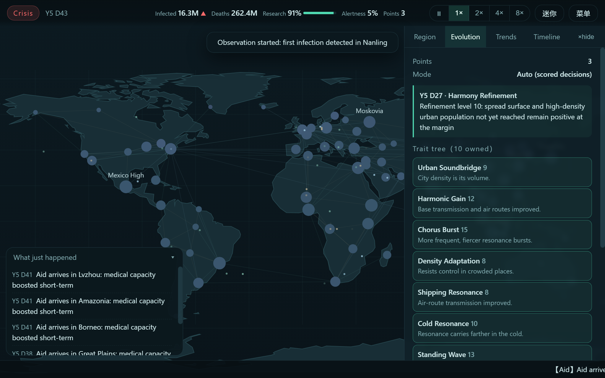
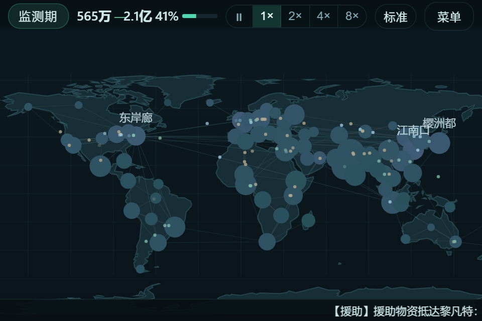
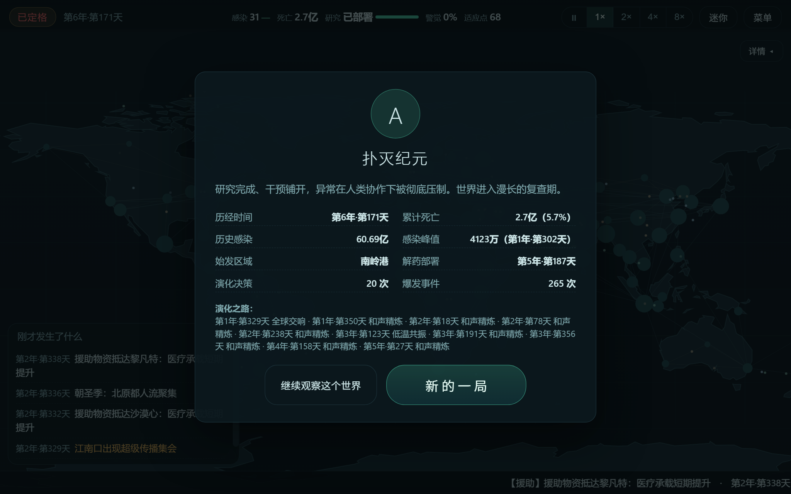

<h1 align="center">MICROWORLD</h1>

  <a href="README.md">中文</a> · <b>English</b>

  
  
  
  
  
  

  

  

**A tiny world that runs by itself on your desk.** Inspired by the core systems of classic pandemic-simulation games, it hands every bit of the grinding back to the world itself: press "One-Click Observe" once, then go about your day — one glance tells you everything.

| | |
|---|---|
|  |  |
| **Mini mode** · keeps running at 480×320 | **Ending review** · grade, stats and the evolution path |

## Why it is different

Games in this genre are **operation-heavy strategy**: click bubbles for resources, pick every evolution by hand, dismiss popups. This game flips the loop — you are the **observer**, not the operator:

| | Traditional | MicroWorld |
|---|---|---|
| Resources | Click bubbles constantly | Accrue on their own as infection spreads |
| Evolution | Manual every time | Auto-scored allocation — **every purchase explains why** |
| Popups & waits | Frequent interruptions | Nothing blocks the flow; key events land in a reviewable timeline |
| Idling | Not supported | The core feature (offline progress capped at 8 h by default) |
| Round length | Unpredictable | 45–120 min by default; pause or speed up (1×–8×) anytime |

The human side is automatic too: surveillance, cure research, aid allocation, traffic closures, regional hygiene campaigns — all driven by world state. When the news announces that a region has closed its airports, the connectivity model really closes them.

## Six original anomalies (distinct mechanics, not reskins)

| Anomaly | Core mechanic | | Anomaly | Core mechanic |
|---|---|---|---|---|
| 🔷 **Crystallize** | The infected turn to crystal; dust rides wind and air routes; research can reverse it | | 🟣 **Dormancy** | Very long latency, nearly invisible; old foci wake in periodic resurgence waves |
| 🟢 **Fog Tide** | Seasonal pulses rising and falling with humid monsoons; sea lanes are its veins | | 🟠 **Etch** | Almost never fatal, yet silently erodes economy and research |
| 🟪 **Resonance** | Amplifies between dense cities; random "chorus" super-spreading events | | 🔴 **Ember Rush** | Fierce and fast; burns itself out once susceptibles run dry |

6 original scenarios (3 complexity tiers) · 49 events (each with triggers, consequences and cooldowns) · 6 ending paths (spread / contained / eradication / collapse / crystal age / self-extinguishing…) — reproducible under the same seed, divergent across seeds.

**Local scenario packs**: Menu → "Import scenario pack" loads JSON packs (validated strictly — unknown parameters, out-of-range values and malformed ids are all rejected). Imported packs run through exactly the same pipeline as the built-in scenarios, persist across sessions, and can be exported again to share. Developers can scan any scenario combination for balance percentiles with `node tools/sweep.js`.

**Optional intervention**: in a region's details, "prioritize aid" gives that region priority in the automatic aid allocation (score ×2.5, never exceeding capacity) — the default remains fully automatic, zero input.

## Getting started

  

- **Recommended**: double-click **`启动微疫世界.bat`** — a dedicated desktop window with always-on-top (the name is Chinese; it is the first .bat in the folder)
- **No-GPU machines**: double-click **`启动微疫世界_无GPU.bat`** — forces pure CPU rendering (still measured at 176 FPS)
- **Universal**: double-click `index.html` (needs Windows 10/11 + Edge or Chrome, usually preinstalled)

Optional setup: world seed, starting region, anomaly type, speed, event frequency, commentary style — or just start immediately.

**Bilingual**: switch the entire game (UI, anomalies, traits, event news, endings) between Chinese and English with one click on the start screen or in Settings; the choice persists.

## Offline progress

When the window is hidden or minimized the game stops drawing and keeps counting time; on return it catches up in batches (default cap 8 h, adjustable to 4/12). Time beyond the cap is fast-forwarded week by week and clearly marked as "approximate". Paused sessions accrue nothing. Clock rollbacks, repeated resumes, sleep/wake and corrupt saves are all guarded — saves hold sim time, three RNG streams, events and full history, in two rotating slots with checksums.

## Tests & performance

Verified headless and in a real browser, zero GPU dependency:

| Metric | Measured |
|---|---|
| Regular regression | 32/32 (conservation, same-seed reproducibility, frame-rate independence, evolution legality, save consistency, no double catch-up, scenario-pack validation, aid priority…) |
| Headless stress | 10/10: 20k-day soak, 72-run full matrix, a 33M-day catch-up storm with exact accounting, 100-world interleaving |
| Real browser | 176 FPS without GPU (0.55 ms/frame), 200/200 save round-trips, zero JS-heap growth |
| Round length | mean 2709 days ≈ **45 min at 1×**, four-plus endings emerge naturally |

> Honest note: the browser runtime's process tree uses ≈740–780 MiB of memory (Chromium baseline), above the 512 MiB budget; the game itself stays under 40 MiB. See the [TODO list](docs/未完成清单.md) (Chinese).

## Docs (Chinese)

[Feature matrix](docs/feature-matrix.md) · [Model notes](docs/模型说明.md) · [Test results](docs/测试结果.md) · [Stress report](docs/压力测试报告.md) · [Asset sources](docs/资源来源.md) · [TODO list](docs/未完成清单.md)

## Design boundaries

- ❌ No network, no IAP, no telemetry of any kind
- ❌ No fake realism: populations, regions and anomalies are fictional gameplay data, mapped to no real pathogen
- ❌ Not a screensaver: a real, pausable, reviewable simulation — and not an operation-heavy strategy game either

## Credits & acknowledgements

- **Gameplay inspiration**: the core systems are inspired by *Plague Inc* (Ndemic Creations), reframed with the austere, observational tone of Mondo Medicals — mechanics inspiration only, **no assets reused** (no names, art, maps, audio or copy).
- **Map outlines**: 110m land data from [Natural Earth](https://www.naturalearthdata.com/) (public domain), packaged by [world-atlas](https://github.com/topojson/world-atlas) (MIT), simplified and redrawn as the backdrop for 80 fictional regions.
- **Tech stack**: vanilla JavaScript + Canvas 2D — zero third-party runtime dependencies, zero build steps; the simulation and renderer are entirely hand-written.

## License

[MIT](LICENSE)

  <a href="README.md">中文</a> · <b>English</b>

