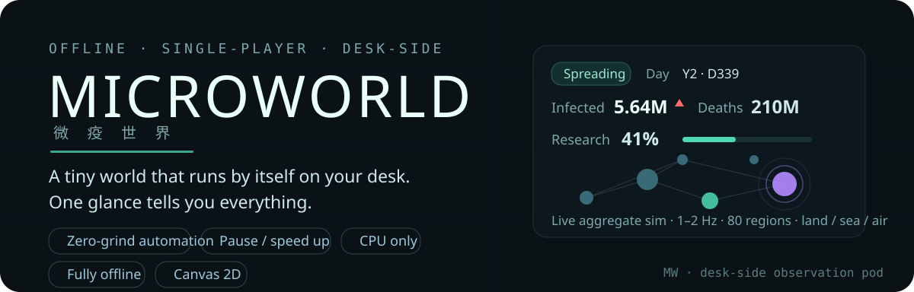

# MicroWorld

[简体中文](README.md) · **English** · [CI](https://github.com/LINYEANSHU/microworld/actions/workflows/ci.yml)



**Press “One-Click Observe” and let the world evolve.**
Anomaly spread, automatic evolution, human research and aid unfold across 80 fictional regions.
Watch the news and map, pause or accelerate time, or prioritize aid for a region.


<details>
<summary>View the narrow layout (390 × 844)</summary>


</details>

Captured during the November 6, 2026 desktop Edge review with GPU, GPU compositing and WebGL disabled. The narrow viewport is not a physical-phone test.

## What unfolds in a round

- **Evolution explains itself.** Resources accrue as the anomaly spreads; automatic scoring picks traits and records the reason for each choice.
- **Human response is automatic.** Surveillance, research, aid and traffic closures affect the same world state; closures change actual connections.
- **Six distinct anomalies.** Crystallize, Fog Tide, Resonance, Dormancy, Etch and Ember Rush combine with six built-in scenarios.
- **Seeds support comparison.** Ending reviews retain indicators, events and the evolution path; the same seed reproduces a run.
- **Local scenario packs.** Import JSON packs through the menu; validated scenarios join the list, persist locally and can be exported again.

This is a fictional simulation game. Its populations, regions, anomalies and parameters are gameplay data, not real disease predictions.

## Getting started

No dependency installation or build is needed. On Windows 10/11 with Edge or Chrome:

1. Download or clone the repository.
2. Double-click `启动微疫世界.bat`.
3. Choose “One-Click Observe”, or select a seed, scenario and anomaly first.

```bash
git clone https://github.com/LINYEANSHU/microworld.git
cd microworld
```

Both Windows launchers now disable GPU, GPU compositing and WebGL by default.
`启动微疫世界_无GPU.bat` remains a compatible entry point. They use a separate browser profile from your everyday browsing.
The launcher attempts to keep the window on top. To disable that behavior:

```powershell
powershell -NoProfile -ExecutionPolicy Bypass -File tools/launch.ps1 -NoTopmost
```

You can also open `index.html` directly. For development or a local HTTP preview, use Node.js 22+:

```bash
node tools/serve.js
```

Open `http://127.0.0.1:8391`. File mode, HTTP addresses and browser profiles may have separate save storage.

## Observation controls

| Action | Input |
| --- | --- |
| Select a region / pan | Click / single-pointer or mouse drag |
| Zoom | Mouse wheel |
| Pause / resume | `Space` or pause button |
| 1× / 2× / 4× / 8× | `1` / `2` / `3` / `4` or speed buttons |
| News, evolution and statistics | “Details” and the corresponding menu panels |
| Prioritize aid | Region details → “Prioritize aid” |
| Chinese/English / mini window | Start screen or Settings / “Mini” |
| Close menu or Settings | `Escape` |

## Saves and offline progress

The running game autosaves every 45 seconds; the menu also offers immediate saving and JSON export/import.
Saves include simulation time, RNG state, events and history, using two rotating `localStorage` slots with checksums.
Export a file for backups or migration before clearing site data.

Resuming after hiding or closing catches up elapsed time, capped at 8 hours by default, with 4/12-hour options. Paused worlds accrue no progress.
Daily simulation has a tick budget; the remainder advances in explicitly marked weekly approximations. Time beyond the offline cap is discarded.
Approximate progress is not equivalent to daily simulation and should not be used as an exact experimental comparison.

## Verification and limits

Re-run on November 6, 2026:

```bash
node test/run-tests.js
node test/smoke.js
```

- **32 / 32 regression tests passed**, covering population conservation, determinism, saves, catch-up, scenario packs and aid priority.
- The smoke script passed, exercising built-in scenario/anomaly combinations. Optional `node test/stress.js` covers long soaks, matrix runs, save rotation and catch-up storms; it was not completed in this pass.
- The same-day Edge review with GPU/WebGL disabled passed **13 browser assertions**, covering desktop/narrow layouts, pause restoration, continued simulation after catch-up, form keys and real scenario-pack uploads.
- Physical phones, screen readers and touch hardware were not tested; pinch zoom is not implemented. Launcher window pinning received static/syntax checks only.
- Vanilla JavaScript and Canvas 2D, with no third-party runtime dependency. Browser memory still includes runtime overhead; no fixed FPS or whole-process memory ceiling is promised.

## Documentation

[Feature matrix](docs/feature-matrix.md) · [Model notes](docs/模型说明.md) · [Asset sources](docs/资源来源.md) (Chinese).
See [DESIGN.md](DESIGN.md) for design boundaries. Historical performance figures apply to their reports' test conditions.

## Contributors

[LINYEANSHU](https://github.com/LINYEANSHU)

## License and sources

Code: [MIT](LICENSE). Map outlines use public-domain [Natural Earth](https://www.naturalearthdata.com/) data, simplified and redrawn from [world-atlas](https://github.com/topojson/world-atlas) (MIT).
Mechanics draw inspiration from [Plague Inc.](https://www.ndemiccreations.com/en/22-plague-inc); no art, maps, audio or copy were reused. The UI uses system fonts.
