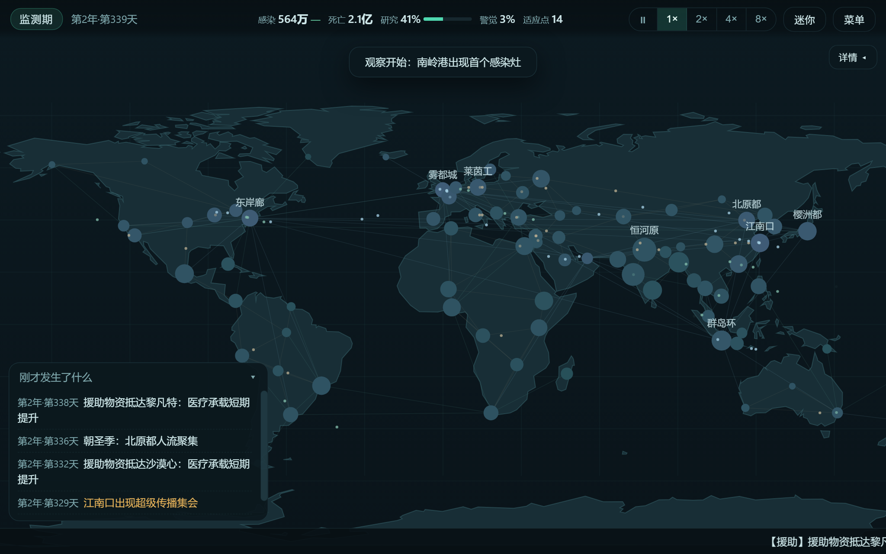
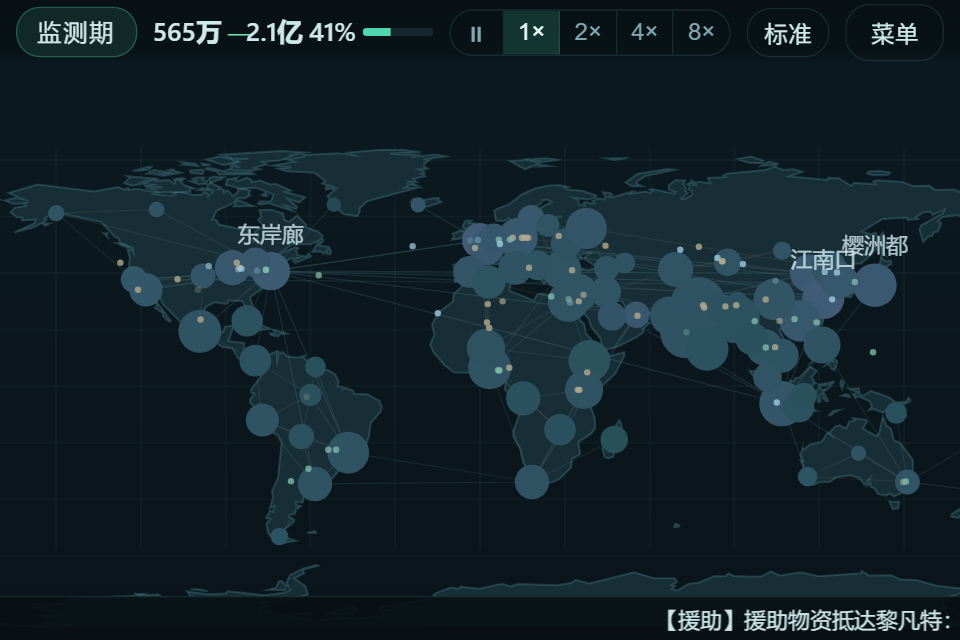
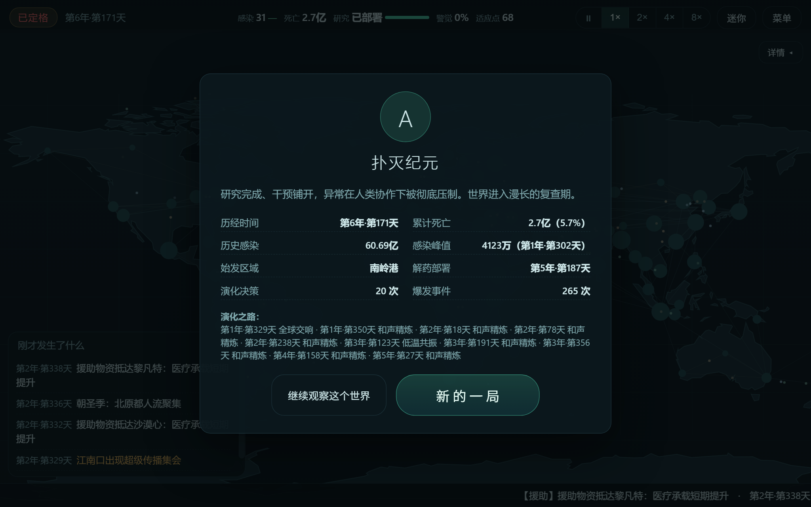

<h1 align="center">微疫世界</h1>

  <b>中文</b> · <a href="README.en.md">English</a>

  
  
  
  
  
  

  

  

**一个放在桌边、自己运行的小世界。** 受经典疫情模拟游戏的核心系统启发，但把所有操作都交还给世界本身：点一次「一键开始观察」，然后该干嘛干嘛去——偶尔看一眼，就知道发生了什么。

| | |
|---|---|
|  |  |
| **迷你模式** · 480×320 小窗照常运行 | **结局复盘** · 评级、统计与演化之路 |

## 为什么不一样

市面上同类游戏是**操作型策略**：点气泡攒资源、手动点进化树、处理弹窗。本作把这套循环整个翻过来——你是**观察者**，不是操作员：

| | 传统操作型 | 微疫世界 |
|---|---|---|
| 获取资源 | 频繁点击气泡 | 随感染规模自动积累 |
| 演化决策 | 每次手动选择 | 自动评分分配，**每次购买都解释为什么** |
| 弹窗与等待 | 频繁打断 | 零阻塞，重要事件进可回看时间线 |
| 挂机 | 不支持 | 核心玩法（离线进度默认上限 8 小时） |
| 一轮时长 | 不定 | 默认 45–120 分钟，可随时暂停/加速（1×–8×） |

人类一侧同样是自动的：监测、解药研究、援助分配、交通封锁、区域卫生运动——全部由世界状态驱动。新闻说哪关闭了航空，连接模型里就真的关了。

## 六种原创异常（机制各异，不是换皮）

| 异常 | 核心机制 | | 异常 | 核心机制 |
|---|---|---|---|---|
| 🔷 **晶化** | 感染者化为晶壳，晶尘随风与航线远播，可被研究逆转 | | 🟣 **休眠** | 超长潜伏极难察觉，旧感染灶周期性“唤醒波”复燃 |
| 🟢 **雾潮** | 随湿热季风涨落的季节脉冲，海运通道是它的血管 | | 🟠 **蚀纹** | 几乎不致死，却静默侵蚀经济与科研能力 |
| 🟪 **共鸣** | 高密度城市间共鸣放大，随机“齐鸣”式超级传播 | | 🔴 **焰袭** | 烈而速，易感烧尽后自我反噬，通道断绝可自熄 |

6 个原创场景（3 档复杂度）· 49 条事件（全部有触发条件、后果与冷却）· 6 种结局走向（传播 / 受控 / 根除 / 覆没 / 晶界 / 自熄…），同种子可复现、跨种子走向不同。

**创意工坊（本地场景包）**：菜单 →「导入场景包」加载 JSON 场景包（校验从严：未知参数、越界数值、非法 id 一律拒绝），导入后与内置场景走完全相同的合成路径，跨会话保留，可再导出分享；开发者可用 `node tools/sweep.js` 对任意场景组合做百分位平衡扫描。

**可选手动干预**：区域详情里「设为优先援助」，该区域在自动援助分配中获得优先权（评分 ×2.5，不突破容量上限）——默认仍是全自动零操作。

## 快速开始

  

- **推荐**：双击 **`启动微疫世界.bat`** —— 独立桌面窗口 + 自动置顶，不影响日常浏览器
- **训练机**：双击 **`启动微疫世界_无GPU.bat`** —— 强制纯 CPU 渲染（实测仍达 176 FPS）
- **通用**：直接双击 `index.html`（需要 Windows 10/11 + Edge 或 Chrome，系统一般自带）

可选设置：世界种子、初始区域、异常类型、速度、事件频率、观察风格——不设置也能直接开始。

**中英双语**：开始屏与设置里一键切换语言（界面、异常、特性、事件新闻、结局全量翻译），选择持久保存。

## 挂机与离线进度

窗口隐藏/最小化时自动停绘并计时；恢复后分批补算（默认上限 8 小时，可调 4/12），超出部分按周快速推进并明确标注「近似处理」。暂停不累计离线进度；时钟回拨、重复恢复、休眠唤醒、坏存档均已防护——存档含模拟时间、三条随机数流、事件与完整历史，双槽轮换 + 校验和。

## 测试与性能

无头 + 真实浏览器双通道验证，全程不依赖 GPU：

| 指标 | 实测 |
|---|---|
| 常规回归 | 32/32 通过（守恒、同种子复现、帧率无关、演化合法性、存档一致、补算不重复、场景包校验、援助优先级…） |
| 无头压力 | 10/10 通过：2万日浸泡、72局全矩阵、3303万日补算风暴账目分毫不差、100世界交错 |
| 真实浏览器 | 无GPU下 176 FPS（单帧 0.55ms）、存档往返 200/200、JS 堆零增长 |
| 一轮时长 | 平均 2709 天 ≈ **45 分钟（1×）**，四种以上结局自然涌现 |

> 诚实说明：浏览器方案进程树内存 ≈740–780 MiB（Chromium 运行时基线），超出 512 MiB 预算目标；游戏自身 <40 MiB。详见 [未完成清单](docs/未完成清单.md)。

## 文档

[功能对照表](docs/feature-matrix.md)（保留/自动化改造/延期/不做） · [模型说明](docs/模型说明.md) · [测试结果](docs/测试结果.md) · [压力测试报告](docs/压力测试报告.md) · [资源来源](docs/资源来源.md) · [未完成清单](docs/未完成清单.md)

## 设计边界

- ❌ 不联网、无内购、无任何数据上报
- ❌ 不冒充真实统计：人口、区域、异常均为玩法虚构数据，不对应任何现实病原
- ❌ 不做成屏保：有真实可暂停、可复盘的模拟；也不重新变成需要频繁点击的策略游戏

## 参考与致谢

- **玩法灵感**：受 Mondo Medicals 风格的《瘟疫公司 Plague Inc》（Ndemic Creations）核心系统启发——仅机制层面的借鉴与重构，**无任何素材复用**（不使用其名称、美术、地图、音效或文案）。
- **地图轮廓**：[world-atlas](https://github.com/topojson/world-atlas)（MIT）打包的 [Natural Earth](https://www.naturalearthdata.com/) 110m 陆地数据（公有领域），简化重绘为本作虚构的 80 区域背景。
- **技术栈**：原生 JavaScript + Canvas 2D——零第三方运行时依赖、零构建步骤，模拟与渲染全部手写实现。

## License

[MIT](LICENSE)

  <b>中文</b> · <a href="README.en.md">English</a>

