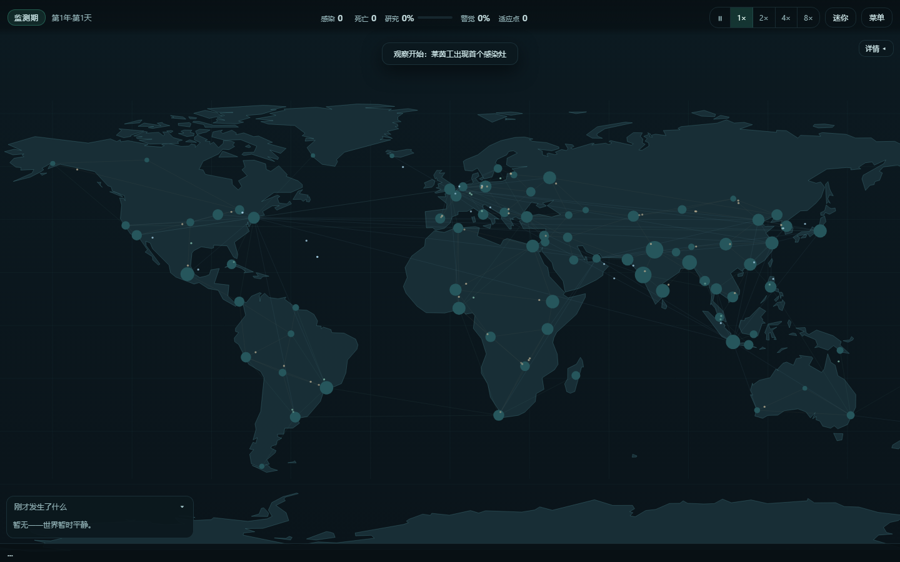
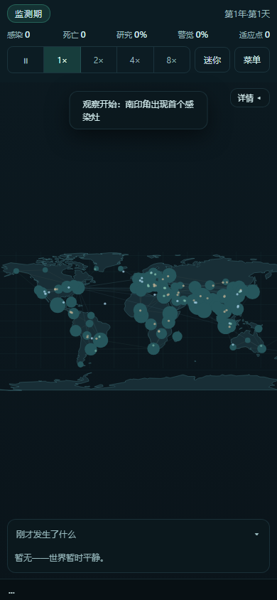

# MicroWorld · 微疫世界

**简体中文** · [English](README.en.md) · [CI](https://github.com/LINYEANSHU/microworld/actions/workflows/ci.yml)


**按一次「一键开始观察」，让世界自己演化。**
80 个虚构区域里的异常传播、自动演化、人类研究与援助同时推进。
你可以只看新闻与地图，也可以暂停、加速，或为某个区域指定优先援助。



<details>
<summary>查看窄屏界面（390 × 844）</summary>



</details>

截图来自 2026-11-06 的桌面 Edge 审查，已关闭 GPU、GPU 合成及 WebGL；窄屏截图不是实机手机测试。

## 一轮世界里会发生什么

- **自动演化有解释**：资源随传播积累，系统评分购买特性，并在演化面板解释选择。
- **人类会自动响应**：监测、研究、援助与交通封锁参与同一世界状态；封锁也改变实际连接。
- **六种异常各有机制**：晶化、雾潮、共鸣、休眠、蚀纹、焰袭，配合六个内置场景产生不同轨迹。
- **同种子可以复现**：结局复盘保留指标、事件和演化路径，方便比较不同场景。
- **本地场景包可扩展**：通过菜单导入 JSON 场景包，校验后加入场景列表，支持持久化与再导出。

这是一款虚构模拟游戏。人口、区域、异常及参数用于玩法，不是现实疾病预测。

## 快速开始

无需安装依赖或构建。Windows 10/11 上准备 Edge 或 Chrome，然后：

1. 下载或克隆仓库。
2. 双击 `启动微疫世界.bat`。
3. 点击「一键开始观察」；需要时在开始屏选择种子、场景与异常。

```bash
git clone https://github.com/LINYEANSHU/microworld.git
cd microworld
```

两个 Windows 启动器现在均默认禁用 GPU、GPU 合成和 WebGL。
`启动微疫世界_无GPU.bat` 保留为兼容入口；使用独立浏览器配置，与日常浏览器分开。
启动器会尝试置顶；不需要时可运行：

```powershell
powershell -NoProfile -ExecutionPolicy Bypass -File tools/launch.ps1 -NoTopmost
```

也可直接打开 `index.html`。开发/本地 HTTP 预览可使用 Node.js 22+：

```bash
node tools/serve.js
```

打开 `http://127.0.0.1:8391`。文件模式、HTTP 地址与不同浏览器配置可能使用不同存档空间。

## 观察操作

| 操作 | 方式 |
| --- | --- |
| 选取区域 / 平移地图 | 点击 / 单指或鼠标拖动 |
| 缩放 | 鼠标滚轮 |
| 暂停 / 继续 | `Space` 或暂停按钮 |
| 1× / 2× / 4× / 8× | `1` / `2` / `3` / `4` 或速度按钮 |
| 复盘新闻、演化与统计 | 「详情」及菜单中的对应面板 |
| 优先援助 | 区域详情 →「设为优先援助」 |
| 中英切换 / 迷你窗口 | 开始屏或设置 /「迷你」 |
| 关闭菜单或设置 | `Escape` |

## 存档与离线进度

运行时每 45 秒自动保存；菜单也可立即保存、导出或导入 JSON。
存档含模拟时间、随机数状态、事件与历史，使用 `localStorage` 双槽轮换和校验和。
导出文件适合备份与跨配置迁移；清理网站数据前请先导出。

隐藏或关闭后恢复时按时间补算，默认最多 8 小时，可选 4/12 小时；暂停不累计进度。
全量补算有 tick 预算，预算内按日模拟，剩余部分按周近似并标注；超过离线上限的时间不继续补算。
近似推进不等价于逐日模拟，不宜把它用于精确实验对照。

## 验证与边界

2026-11-06 重新执行：

```bash
node test/run-tests.js
node test/smoke.js
```

- 常规回归 **32 / 32 通过**；覆盖人口守恒、确定性、存档、离线补算、场景包与援助优先级。
- 冒烟脚本通过，检查内置场景/异常组合。可选 `node test/stress.js` 覆盖长时浸泡、矩阵运行、存档轮换及补算风暴，本轮未完整运行。
- 同日 GPU/WebGL 禁用的 Edge 审查通过 **13 项浏览器断言**，覆盖桌面/窄屏、暂停恢复、补算后继续、表单按键和真实场景包上传。
- 未验证真实手机、屏幕阅读器或触控硬件；未实现双指缩放。启动器置顶只做过静态/语法检查。
- 原生 JavaScript + Canvas 2D，无第三方运行时依赖；浏览器整体内存仍有运行时开销，不承诺特定 FPS 或整机内存上限。

## 文档

[功能对照](docs/feature-matrix.md) · [模型说明](docs/模型说明.md) · [资源来源](docs/资源来源.md)。
开发与玩法边界见 [DESIGN.md](DESIGN.md)；历史性能数据以对应报告的测试条件为准。

## 贡献者

[LINYEANSHU](https://github.com/LINYEANSHU)

## 许可与来源

代码采用 [MIT](LICENSE)。地图轮廓来自 [Natural Earth](https://www.naturalearthdata.com/) 公有领域数据，经 [world-atlas](https://github.com/topojson/world-atlas)（MIT）处理后简化重绘。
玩法受到 [Plague Inc.](https://www.ndemiccreations.com/en/22-plague-inc) 的机制启发；未复用其美术、地图、音效或文案。界面使用系统字体。
